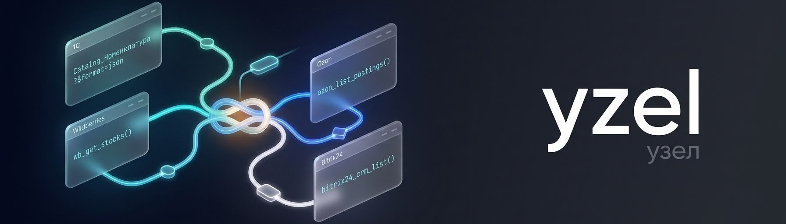

<p align="center">
  
</p>

<p align="center">
  <b>Подключите AI-ассистента к 1С, Wildberries и Ozon.</b> Открытый хобби-проект на MCP.<br>
  <b>Connect your AI assistant to 1C, Wildberries and Ozon.</b> An open-source MCP hobby project.
</p>

<p align="center">
  <a href="https://github.com/Aiyo28/yzel/releases/latest"><b>⬇ Установить в Claude Desktop / Install in Claude Desktop</b></a>
</p>

<p align="center">
  <a href="https://pypi.org/project/yzel/"></a>
  <a href="https://github.com/Aiyo28/yzel/actions/workflows/ci.yml"></a>
  <a href="LICENSE"></a>
  <a href="https://mcprush.com/to/yzel-1c-enterprise-mcp?ref=badge"></a>
</p>

<!-- mcp-name: io.github.Aiyo28/yzel -->

Yzel подключает Claude, ChatGPT и других AI-ассистентов к 1С:Предприятию, Битрикс24, AmoCRM, МойСкладу, Wildberries, Ozon, Telegram и iiko через [Model Context Protocol](https://modelcontextprotocol.io). Открытый код, MIT, без платных тарифов и закрытых модулей.

Yzel connects Claude, ChatGPT and other AI assistants to 1C:Enterprise, Bitrix24, AmoCRM, MoySklad, Wildberries, Ozon, Telegram and iiko over the [Model Context Protocol](https://modelcontextprotocol.io). Open source, MIT, no paid tiers, no closed modules.

---

## Откуда это / How it started

Друг попросил подключить Claude к своей 1С, а мне хотелось следить за Wildberries через AI. Я сделал и то, и другое, а потом добавил сервисы, которыми пользуются вокруг меня: Ozon, МойСклад, Битрикс24, AmoCRM, Telegram, iiko. Это хобби-проект: делаю в свободное время, бесплатно, под MIT.

A friend asked me to connect Claude to their 1C, and I wanted AI to keep an eye on Wildberries. So I built both, then added the other services people around me use: Ozon, MoySklad, Bitrix24, AmoCRM, Telegram, iiko. It's a hobby project: built in spare time, free, MIT.

---

## Поддерживаемые сервисы / Supported connectors

| Сервис / Service | API | Авторизация / Auth | Статус |
|---|---|---|---|
| **1С:Предприятие** (on-prem + Fresh) | OData v3 + JSON | Basic Auth | ✅ Stable |
| **Wildberries** Seller API | REST (5 хостов) | JWT token | ✅ Stable |
| **Ozon** Seller API | REST | Client-Id + Api-Key | ✅ Stable |
| **Bitrix24** | REST | Webhook URL | ✅ Stable |
| **AmoCRM / Kommo** | REST v4 | OAuth2 (3mo refresh guard) | ✅ Stable |
| **МойСклад** | JSON API 1.2 | Bearer Token | ✅ Stable |
| **Telegram Bot** | Bot API | Bot Token | ✅ Stable |
| **iiko Cloud** (F&B POS) | REST | apiLogin → 1h Bearer | ✅ Stable |

Все восемь коннекторов ставятся одним пакетом, с общим хранилищем ключей и одним CLI. / All eight connectors ship in one package, with one credential store and one CLI.

Планируется / On the roadmap: WhatsApp (через `wacli` sidecar), goszakup.gov.kz, Zoom / Google Meet / Yandex Telemost. См. / See [ROADMAP.md](ROADMAP.md).

---

## Установка / Install

### Попробовать одной командой / Try it with one command

```bash
uvx --from yzel yzel --help
```

`uvx` скачивает пакет и запускает его, ставить заранее ничего не нужно. Нужны [uv](https://docs.astral.sh/uv/) и Python 3.11+; работает на Windows без WSL. Если uv уже стоит, первый запуск занимает около 4 секунд.

`uvx` fetches the package and runs it, nothing to install first. Needs [uv](https://docs.astral.sh/uv/) and Python 3.11+; works on Windows without WSL. With uv already installed, the first run takes about 4 seconds.

Пакет опубликован в [PyPI](https://pypi.org/project/yzel/) и в официальном MCP Registry как `io.github.Aiyo28/yzel`. / Published on [PyPI](https://pypi.org/project/yzel/) and in the official MCP Registry as `io.github.Aiyo28/yzel`.

### Claude Desktop в один клик (1С) / Claude Desktop, one click (1C)

1. Скачайте `yzel-1c-<версия>.mcpb` со страницы [последнего релиза](https://github.com/Aiyo28/yzel/releases/latest) / Download the `.mcpb` from the latest release.
2. Откройте файл двойным щелчком, Claude Desktop покажет окно установки / Double-click it; Claude Desktop opens an install dialog.
3. Введите адрес OData, пользователя и пароль 1С / Enter the OData URL, 1C user and password.
4. Флажок «Только чтение» включён по умолчанию: Claude видит только инструменты чтения. Снимите его, чтобы разрешить запись / The «Только чтение» (read-only) checkbox is on by default: Claude sees only the read tools. Untick it to allow writes.

Python и зависимости Claude Desktop ставит сам, терминал не нужен. Пароль хранится в настройках Claude Desktop и уходит только на ваш сервер 1С.

Claude Desktop installs Python and dependencies itself, no terminal. The password stays in Claude Desktop's settings and is sent only to your 1C server.

### pip

```bash
pip install yzel        # или / or: uv tool install yzel
```

Из исходников: см. [Разработка / Development](#разработка--development).

---

## Быстрый старт / Quick start

### 1. Настройте подключение / Configure a connection

```bash
# 1С (on-prem)
yzel config add-1c

# 1С:Fresh (облако)
yzel config add-1c --fresh

# Wildberries
yzel config add-wildberries

# Все остальные / any other
yzel config add-bitrix      # Битрикс24
yzel config add-amocrm      # AmoCRM
yzel config add-moysklad    # МойСклад
yzel config add-ozon        # Ozon
yzel config add-telegram    # Telegram Bot
yzel config add-iiko        # iiko Cloud

# Список подключений / list connections
yzel config list
```

Учётные данные хранятся зашифрованными (AES-256) в локальном SQLite-vault `~/.yzel/store.db`. Ничего не отправляется в облако. / Credentials are stored encrypted (AES-256) in a local SQLite vault at `~/.yzel/store.db`. Nothing goes to a cloud.

Для 1С вместо vault можно задать переменные окружения, они имеют приоритет / For 1C, env vars can replace the vault and take precedence: `YZEL_1C_URL`, `YZEL_1C_USERNAME`, `YZEL_1C_PASSWORD` (пароль может быть пустым / the password may be empty).

Чтобы скрыть и запретить все инструменты записи, задайте `YZEL_READ_ONLY=1` / To hide and refuse every write tool, set `YZEL_READ_ONLY=1`.

### 2. Подключите к Claude Desktop / Wire into Claude Desktop

Добавьте в / Add to `claude_desktop_config.json`:

```json
{
  "mcpServers": {
    "yzel-1c":       { "command": "uvx", "args": ["--from", "yzel", "yzel-1c"] },
    "yzel-bitrix24": { "command": "uvx", "args": ["--from", "yzel", "yzel-bitrix24"] }
  }
}
```

Каждый коннектор это отдельный MCP-сервер. Подключайте только нужные. / Each connector is its own MCP server. Add only the ones you need.

| Коннектор | Команда / command | Коннектор | Команда / command |
|---|---|---|---|
| 1С | `yzel-1c` | Ozon | `yzel-ozon` |
| Битрикс24 | `yzel-bitrix24` | Telegram | `yzel-telegram` |
| AmoCRM | `yzel-amocrm` | iiko | `yzel-iiko` |
| МойСклад | `yzel-moysklad` | Wildberries | `yzel-wildberries` |

Каждая / Each: `{ "command": "uvx", "args": ["--from", "yzel", "<команда>"] }`.

### 3. Спрашивайте данные у AI / Ask the AI

```
Покажи последние 10 реализаций товаров из 1С за эту неделю,
сгруппируй по контрагентам.
```

```
Найди все сделки в стадии «Переговоры» в AmoCRM,
у которых нет связанной задачи.
```

```
Выведи остатки товара «Ноутбук HP» из МойСклада
и текущие цены на Wildberries.
```

---

## Особенности 1С / 1C-specific features

Каждая 1С-инсталляция уникальна. Что делает коннектор:

- **Находит схему сам.** На старте парсится `$metadata`: коннектор узнаёт доступные справочники, документы, регистры, включая кастомные.
- **Кириллические имена как есть.** `Catalog_Номенклатура` остаётся `Catalog_Номенклатура`, без транслитерации.
- **Streaming-парсинг `$metadata`.** Конфигурации ERP могут давать 10+ МБ XML. Yzel не загружает всё в память.
- **Сам различает 1С:Fresh и on-prem.** Разные форматы адреса (`1cfresh.com/a/sbm/<id>/odata/` и `<host>/<base>/odata/`) обрабатываются без настройки.
- **Basic Auth без токен-сессий.** В 1С нет refresh-потока, каждый запрос отправляет base64(user:pass). Yzel не изобретает несуществующую token-refresh логику.
- **Без BSL-расширений.** Yzel подключается к опубликованным OData/HTTP API. Менять конфигурацию 1С не нужно.

Если получаете `EmptySchemaError`, см. [`docs/TROUBLESHOOTING-1C.md`](docs/TROUBLESHOOTING-1C.md).

---

## Известные ограничения / Known limitations

- **Тесты идут против mock-серверов, которые я написал сам.** Если сервис поменял API, тесты этого не увидят. Повторяемой проверки на живых аккаунтах пока нет: журнал в [`docs/LIVE-CHECKS.md`](docs/LIVE-CHECKS.md) пуст.
- **1С на живом 1С:Fresh проверена только до транспорта и `$metadata`.** Пробные тенанты Fresh не публикуют объекты через OData, поэтому чтение и запись данных на реальной базе не подтверждены. Для этого нужна on-prem база или платный Fresh с правами администратора.
- **Запись в 1С:** create, update и delete через OData. Проведение документов и регистры накопления с транзакциями не сделаны.
- **В один клик ставится только 1С.** Остальные семь коннекторов ставятся через `uvx` и конфиг клиента.
- **MCP SDK закреплён на `<2.0`.** Переход на mcp 2.x ещё не сделан.
- **AmoCRM:** готовые токены вводятся через CLI, встроенного OAuth в браузере пока нет.
- **WhatsApp и goszakup.gov.kz** пока не поддерживаются.

In English:

- **Tests run against mock servers I wrote myself.** If a service changes its API, the tests can't see it. There is no repeatable live-account check yet: the run log in [`docs/LIVE-CHECKS.md`](docs/LIVE-CHECKS.md) is empty.
- **1C is verified on a live 1C:Fresh endpoint up to transport and `$metadata` only.** Fresh trial tenants don't publish objects over OData, so reading and writing data on a real infobase is unconfirmed. That needs an on-prem infobase or a paid Fresh tenant with admin rights.
- **1C writes:** create, update and delete over OData. Posting documents and accumulation registers with transactions are not done.
- **Only 1C installs in one click.** The other seven connectors go through `uvx` and the client config.
- **The MCP SDK is pinned to `<2.0`.** The mcp 2.x port is not done.
- **AmoCRM:** tokens are entered through the CLI; there is no built-in browser OAuth flow yet.
- **WhatsApp and goszakup.gov.kz** are not supported yet.

---

## Архитектура / Architecture

```
~/.yzel/store.db       ← зашифрованные credentials (AES-256)
       │
       ├── Yzel CLI     ← добавление/удаление подключений
       │
       └── MCP-серверы  ← по одному на коннектор
           ├── 1C (OData v3, Cyrillic-aware, streaming $metadata)
           ├── Wildberries (5 хостов, per-host rate limits)
           ├── Ozon (dual-header auth, sandbox support)
           ├── Bitrix24 (webhook, leaky-bucket 2 req/sec)
           ├── AmoCRM (OAuth2 + 3mo refresh-staleness guard)
           ├── Moysklad (Bearer, rate limiter, expand-aware)
           ├── Telegram (retry_after handling)
           └── iiko (apiLogin → 1h Bearer, auto-refresh)
                    │
                    └── Claude / ChatGPT / любой MCP-клиент
```

Каждый коннектор:
- Отдельный пакет в `src/yzel/connectors/<name>/`
- Собственный mock-сервер для тестов (`tests/mock_<name>_server.py`)
- Типизированные ошибки с `status_code` + RU-сообщения для MCP
- Без модификаций клиентских систем, только публичные API

---

## Разработка / Development

```bash
git clone https://github.com/Aiyo28/yzel.git
cd yzel
uv sync --extra dev

uv run pytest
uv run pytest tests/test_onec.py                # один коннектор / one connector
uv run python -m yzel.connectors.onec.server    # MCP-сервер из исходников / server from source
```

Модули серверов / server modules: `yzel.connectors.<name>.server`, где / where `<name>` = `onec`, `wildberries`, `ozon`, `bitrix24`, `amocrm`, `moysklad`, `telegram`, `iiko`.

Протокол для агентов и особенности каждого API: [CLAUDE.md](CLAUDE.md). Как прислать изменения: [CONTRIBUTING.md](CONTRIBUTING.md).

Issues и PR приветствуются. Особенно / Especially welcome:
- Тестирование против реальных конфигураций 1С (Бухгалтерия, УТ, ERP, Fresh)
- Новые коннекторы (WhatsApp, goszakup, meeting platforms)
- Переводы error-messages
- Документация use-case'ов

---

## Лицензия и поддержка / License and support

[MIT](LICENSE), весь код. Без BSL и закрытых модулей. Yzel некоммерческий и не продаётся.

[MIT](LICENSE), all of it. No BSL, no closed modules. Yzel is non-commercial and not for sale.

Если Yzel сэкономил вам время, можете угостить кофе. / If Yzel saved you time, you can buy me a coffee.

[](https://paypal.me/aiyo28)
[](https://ko-fi.com/aiyo1939)

Любая сумма, любая валюта / any amount, any currency.

Автор / Author: [Айал Ноговицын / Ayal Nogovitsyn](https://github.com/Aiyo28). Живу в Казахстане, пишу по-русски. / KZ-based, RU-speaking.
