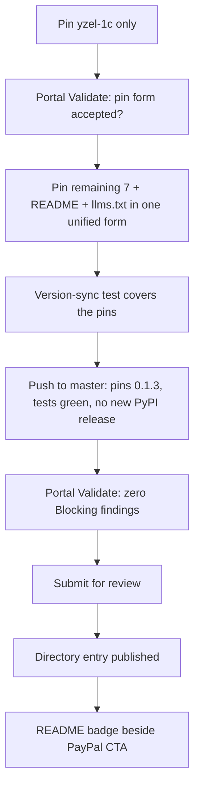

## Problem Statement

Anthropic opened a plugin directory (claude.ai/directory/manage, 2026-09-25). Yzel already ships a **Plugin** (`.claude-plugin/plugin.json` + `.mcp.json`), and `claude plugin validate` passes. The directory's own checks, though, **block** it: every `.mcp.json` entry runs `uvx --from yzel yzel-<connector>` unpinned, which the pre-submission checklist marks *Blocks — "Unpinned uvx launcher"*. Until that is fixed, Yzel can't get a **Directory entry**, so a Claude user searching "1C" in the directory finds nothing.

## Solution

Pin every launcher to the released version and hold that pin in sync through the existing version test. Then run portal Validate, submit, and after approval add a directory badge beside the PayPal CTA. Expect a reviewer hold ("Runs a pinned uvx package" is always held), so publication is not a same-day event.

## Glossary (Ubiquitous Language)

Terms used here — **Plugin**, **Registry entry**, **Console script**, **Directory entry**, **Pinned launcher**, **Portal Validate**, **Reviewer hold** — are defined in `docs/GLOSSARY.md`.

## User Stories

1. As a Claude Code user, I want to find Yzel by searching the directory for "1C" or "Bitrix24", so that I don't need to know the GitHub URL.
2. As a Claude Code user installing the Plugin, I want every connector to start the exact version the directory scanned, so that what was reviewed is what runs.
3. As the maintainer, I want a release to fail tests if any Pinned launcher (plugin, README or llms.txt) disagrees with `pyproject.toml`, or if any unpinned launcher remains, so that a version bump can't ship stale pins. This test file exists because versions drifted twice in one afternoon.
4. As the maintainer, I want the README to say what the Plugin runs (8 stdio servers fetched from PyPI via uvx) and where credentials live (`~/.yzel/store.db`, local, never sent anywhere), so that the security scan finds nothing undisclosed.
5. As a visitor, I want a directory badge beside the PayPal CTA, so that the donation surface and the install surface sit together.

## Implementation Decisions

- **Pinned launchers:** all 8 `.mcp.json` entries move from `--from yzel` to `--from yzel==<version>`. The source of truth stays `pyproject.toml`, the same rule `tests/test_versions.py` already enforces for `server.json`, `plugin.json`, `llms.txt` and `__init__`.
- **Version-sync test:** extend `tests/test_versions.py`, the existing file, with one parametrized test. Every `uvx --from yzel…` occurrence in `.mcp.json`, `README.md` and `llms.txt` must read `yzel==<pyproject version>`, and an unpinned `--from yzel ` anywhere fails. This keeps `pyproject.toml` as the single source of truth, as the file's docstring already requires.
- **One pinned form everywhere (unified):** every place that tells someone how to launch a connector uses the same pinned form `uvx --from yzel==<version> yzel-<connector>`. That covers the 8 plugin `.mcp.json` entries, the README Claude Desktop snippets and the per-connector line (README ~L56, L111–126), `llms.txt`, and the RELEASE_NOTES template. `server.json` already pins through its `version` field. This reverses the earlier "README stays unpinned" choice: one form means a user copying from the README runs exactly what the directory reviewed, and there is no second syntax to explain. Trade-off accepted: a new release now also bumps the README, and the version test catches any miss.
- **Root `CLAUDE.md` stays.** It is the maintainer's operator letter for coding agents, not plugin context, so the validator warning is accepted, not fixed.
- **Credentials unchanged.** The local AES vault remains. The checklist's *userConfig `sensitive: true`* rule targets credentials written into plugin files, and Yzel writes none. Migrating is out of scope (see Out of Scope).
- **Release:** the pin change needs a published version whose PyPI artifact matches. Either cut 0.1.4 (pins included) or pin 0.1.3, which is already on PyPI. **Recommended: pin 0.1.3.** Code is unchanged, so no new PyPI release is needed.
- **Submission:** plugin folder = repo root, tracked branch = `master`. Turn on auto-publish only if the reviewer grants it.

## Testing Decisions

- The single new test (story 3) checks behavior: a release with a mismatched pin fails. Model it on `test_plugin_manifest_matches`.
- `claude plugin validate .` must pass (the warning is acceptable).
- Manual: install the Plugin from the local folder, start `yzel-1c` once, and confirm the pinned version resolves (`yzel --version` in the handshake).
- Portal Validate is the acceptance gate: zero **Blocking** findings.

## Out of Scope

- Migrating credentials to `userConfig` (a large change, not required by any Blocking rule).
- A remote MCP server / claude.ai **connector** submission. Yzel is stdio-only by design, which fits Windows boxes without WSL.
- New connectors, and the PyPI or MCP Registry flow (both already shipped).

## Non-Goals

Generic checklist: `_shared/non-goals.md`.

| # | Looks like success | Actually means |
|---|---|---|
| 0 | All 8 entries pinned in one commit | If the portal rejects the `--from` pin form, all 8 need redoing. Pin one, validate, then the rest. |
| 1 | `claude plugin validate` is green | It only checks formatting. The directory's Blocking rules run in Portal Validate. Done = Portal Validate green. |
| 2 | Pins match today | Without the version test, the next release ships stale pins and the directory serves an old connector. |
| 2b | `.mcp.json` pinned | A README snippet or llms.txt line still unpinned means two install forms. Unified = zero `--from yzel ` (unpinned) matches in the repo outside CHANGELOG / old release notes. |
| 3 | "Submitted" | A reviewer hold can sit for days. Done = Directory entry published, or a written reviewer response. |
| 4 | README badge added before approval | The badge would point to a page that doesn't exist yet. It lands only after publication. |

## Further Notes

- Decision: `knowledge-os/Projects/Decisions/2026-09-28 — Submit Memento OS then Yzel to the Claude plugin directory.md` (`[D]#9784`). Sequenced **after** Memento OS.
- Sources: https://claude.com/docs/plugins/pre-submission-checklist · https://claude.com/docs/plugins/submit
- **Open — pin syntax.** The checklist's example is `uvx <package>==1.2.3`, meaning package name = command name. Yzel's commands (`yzel-1c`, …) differ from its package (`yzel`), so `--from` is unavoidable: `uvx --from yzel==0.1.3 yzel-1c`. This is the standard uv way to pin, but the docs don't show it, and no approved plugin in `anthropics/claude-plugins-official` uses a pinned `--from` (the only uvx one, `serena`, is unpinned `--from git+…`). **First step of implementation: pin one entry, run Portal Validate, and read the result before touching the other 7.** If it still says "Unpinned uvx launcher", send the exact message to `directory@anthropic.com`; `uvx` has no other syntax that pins a package whose command name differs.
- **README examples:** the directory's pin rule only targets `.mcp.json` and hook commands, but the README is pinned anyway for one unified form (see Implementation Decisions).
- **Security review expectation:** Anthropic's curated-marketplace review prompt (`anthropics/claude-plugins-official/.github/policy/prompt.md`) reads the whole repo, `tests/` and dotdirs included. Yzel sends each service's credential only to that same service, which the prompt explicitly lists as normal ("Do NOT flag… a plugin using the user's OWN credential for service X to call service X's own API"). It will flag `may_download_additional_software` (uvx) and `may_make_external_network_calls`, which are flags, not fails. `.vault-cache` is gitignored, so it doesn't ship.
- Name check (2026-09-28): no plugin named `yzel` among the 314 in Anthropic's official marketplace. Pending submissions and connector names are not visible here, so Portal Validate still has the final word.
