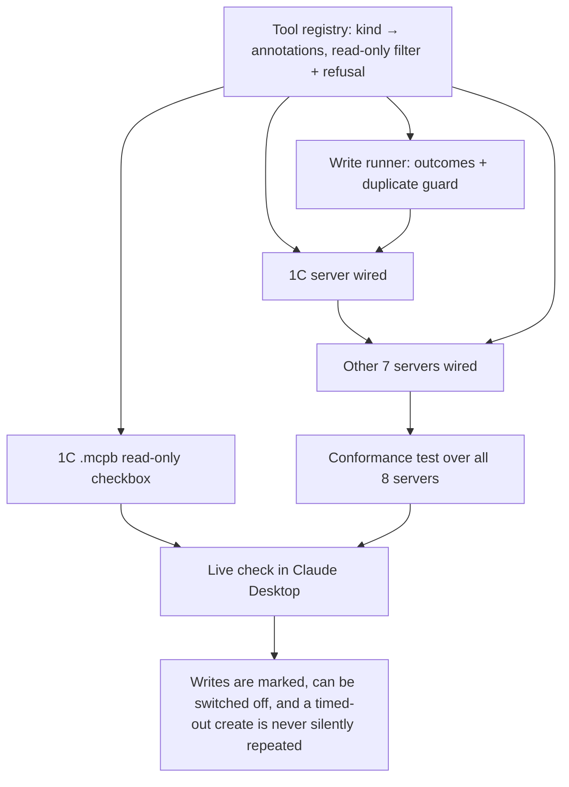

# Spec: write safety and retry safety for Yzel's 22 write tools

Status: built for slices 1-4; slice 5 (release + live check) pending · 2026-11-09 · source: crossbar comparison (`github.com/prantikmedhi/crossbar`, `src/mcp.mjs`)

## Problem Statement

Yzel exposes 68 tools across 8 MCP servers. 22 of them change data in a client's 1C, CRM, POS,
marketplace cabinet or Telegram bot (21 by name, plus `tg_get_updates`, see below). Three things are wrong with how those writes reach an agent:

1. **A timed-out create looks like a failed create, so the agent repeats it.** Every client uses
   a 30 s `httpx` timeout and no connector catches transport errors. When `onec_create` or
   `iiko_create_delivery` times out after the server has already committed, the MCP SDK returns
   `isError: true` with the exception text, which for `httpx.ReadTimeout` can be an empty string.
   The agent's natural next step is to call the tool again. The result is a second
   `Document_РеализацияТоваровУслуг` in 1C, or a second delivery order cooked in a restaurant.
2. **A rejected write looks like a success.** Every server catches its typed error (`OneCError`,
   `IikoError`, …) and returns the RU message as ordinary content, with `isError: false`. The
   agent cannot tell "1C refused this document" from "1C created it".
3. **No tool says what it does.** No tool carries MCP annotations. By the spec's defaults, all 46
   read tools present as possibly destructive, so the client asks before `onec_count` the same way
   it asks before `onec_delete`. A user who clicks "allow" on reads forty times stops reading the
   prompt that matters. There is also no way to connect Yzel to a production 1C and be sure
   nothing gets written.

## Solution

- Every tool declares one **tool kind**, and the kind produces its MCP annotations. A tool cannot
  be built without a kind.
- **Read-only mode** (`YZEL_READ_ONLY=1`, and a checkbox in the 1C `.mcpb` install dialog)
  removes every write tool from `list_tools` *and* refuses them in `call_tool`.
- Every write ends in exactly one **write outcome** (table below), with `isError` set to match.
- A **duplicate guard** refuses an identical create within 10 minutes unless the agent passes
  `again: true`. **The guard is the guarantee.** After a timeout nobody knows the new record's
  GUID, and the Telegram Bot API cannot read back what a bot sent, so a check through a read
  tool is a hint the message offers where one exists, never the protection.

What the user sees: Claude asks before writes and not before reads; the 1C install dialog offers
"Только чтение"; a timed-out 1C document says «Документ мог быть создан. Не повторяйте —
проверьте через onec_query.» instead of an empty error.

## Glossary (Ubiquitous Language)

Canonical copy: [`docs/GLOSSARY.md`](../GLOSSARY.md).

| Term | Definition | Aliases to avoid |
|---|---|---|
| tool kind | One of `read`, `create`, `update`, `delete`; declared once per tool | category, type, mode |
| read tool | Kind `read`: changes nothing in the client's system | safe tool, query tool |
| create tool | Kind `create`: adds a record or sends a message; repeating it adds another | insert, post |
| check tool | The read tool a `may_have_applied` message suggests for looking; a hint, not a guard | verify tool |
| update tool | Kind `update`: overwrites values; repeating it with the same input changes nothing more | patch, set |
| delete tool | Kind `delete`: removes or marks for deletion; repeating it changes nothing more | remove |
| write tool | Any tool whose kind is not `read` (create, update or delete) | mutating tool, action |
| read-only mode | Server state where only read tools are listed and callable | safe mode, dry run |
| write outcome | The single result class of one write call (table below) | status, result |
| duplicate guard | In-process refusal of an identical create call within 10 min | dedupe, idempotency key |

## User Stories

1. As an accountant connecting Claude to a production 1C for the first time, I want to tick
   "Только чтение" in the install dialog, so that nothing can be written until I trust it.
2. As a Claude Desktop user, I want to be asked before writes and not before reads, so that the
   prompt I do see means something.
3. As an agent whose `onec_create` timed out, I want to be told the document may exist, and my
   identical resend refused, so that I don't create it twice.
4. As an agent whose create was refused by 1C (400), I want `isError: true` and the RU reason, so
   that I fix the input instead of reporting success.
5. As a restaurant owner, I want a second identical `iiko_create_delivery` within 10 minutes
   refused unless the agent says `again`, so that a retry loop cannot send two couriers.
6. As an agent whose `ozon_update_prices` timed out, I want to be told resending is safe, so that
   I finish the job instead of stalling.
7. As a contributor adding a tool, I want the build to fail if I forget its kind, so that a new
   write tool cannot ship unmarked.

## Implementation Decisions

**Tool kind → annotations** (per the MCP spec: `destructiveHint` true means the tool may
overwrite; false means it only adds):

| Kind | readOnlyHint | destructiveHint | idempotentHint | openWorldHint | In read-only mode |
|---|---|---|---|---|---|
| read | true | — | — | true | listed |
| create | false | false | false | true | hidden + refused |
| update | false | true | true | true | hidden + refused |
| delete | false | true | true | true | hidden + refused |

**Write outcome**: the contract every write call returns. The agent reads `outcome` first.

| What happened | `outcome` | isError | Message tells the agent |
|---|---|---|---|
| 2xx | `applied` | false | the result |
| Server answered ≥400 (typed error, incl. 429) | `rejected` | true | the RU reason; nothing was written; fix and resend |
| Request never left: `ConnectError`, `ConnectTimeout`, `PoolTimeout` | `not_sent` | true | nothing was written; resend is safe |
| `ReadTimeout`, `WriteTimeout`, `RemoteProtocolError`, or 5xx, on a **create** tool | `may_have_applied` | true | do **not** resend; the identical call will be refused; look with the check tool if there is one |
| Same, on an **update** or **delete** tool | `may_have_applied` | true | resend is safe (same input, same result) |
| Identical create (same tool, same canonical args) within 10 min of `applied` or `may_have_applied`, no `again` | `duplicate_refused` | true | look first (check tool, or the chat for Telegram); pass `again: true` only after looking |
| Any write tool called in read-only mode | `refused` | true | read-only mode is on; nothing was sent |

5xx counts as `may_have_applied`, not `rejected`, because the server may commit and then fail;
the conservative reading costs one check, the other costs a duplicate.

**Modules**

- **Tool registry (`yzel.core`)**: builds a `Tool` from name, description, schema and kind;
  there is no way to build one without a kind. Answers "is read-only mode on" (read from the env
  on each call) and filters a tool list for it. Create tools get the optional `again` boolean added to
  their schema here, not by hand.
- **Write runner (`yzel.core`)**: one entry point that takes the tool's kind, its arguments, the
  name of its check tool (or none), and the client call. It runs the duplicate guard, runs the
  call, maps the exception to a write outcome, records creates for the guard, and returns MCP
  content with `isError` set. Reads typed errors' HTTP status through one accessor, because
  `AmoCRMError` names it `status` while the other seven use `status_code`.
- **8 connector servers**: each declares a kind for each tool and a check tool for each create, sends
  writes through the write runner, and sets `isError: true` on typed errors from reads.
- **1C Desktop Extension**: adds a boolean `user_config` "Только чтение / Read-only" mapped to
  `YZEL_READ_ONLY`.

**The 22 write tools**

| Kind | Tools | Check tool |
|---|---|---|
| create (9) | `onec_create`, `amocrm_create`, `bitrix24_crm_create`, `moysklad_create`, `iiko_create_delivery`, `tg_send_message`, `tg_send_photo`, `tg_send_document`, `tg_answer_callback` | `onec_query`, `amocrm_list`, `bitrix24_crm_list`, `moysklad_list`, `iiko_deliveries_by_phone`; Telegram ×4: none (the Bot API has no sent-message history) |
| update (10) | `onec_update`, `amocrm_update`, `bitrix24_crm_update`, `moysklad_update`, `ozon_update_stocks`, `ozon_update_prices`, `wb_update_stocks`, `tg_edit_message`, `tg_set_webhook`, `tg_get_updates` | resend is safe |
| delete (3) | `onec_delete` (sets DeletionMark), `tg_delete_message`, `tg_delete_webhook` | resend is safe |

`tg_get_updates` is listed as `update`, not `read`: calling it with `offset` confirms earlier
updates and Telegram drops them, so it hides in read-only mode. That makes 46 read tools and 22
write tools, not the 47/21 split counted from tool names.

**Unchanged on purpose**: clients keep their single 30 s timeout and never retry by themselves;
iiko's one retry after a 401 stays, because a 401 means the request was not processed.

## Testing Decisions

- Test behaviour at the MCP boundary (`list_tools` / `call_tool` results), not the runner's
  internals. Prior art: the per-connector mock servers in `tests/mock_*_server.py` and the
  `Server`-level check in `tests/test_versions.py`.
- **Conformance test, all 8 servers**: every listed tool has annotations; with
  `YZEL_READ_ONLY=1` the listed set is exactly the read tools, and calling a hidden write tool
  returns `isError: true` without any HTTP request reaching the mock. Fails on master today.
- **Timeout test**: a mock 1C that commits the record and then answers after the client timeout.
  `onec_create` returns `may_have_applied` naming `onec_query`; the same call again returns
  `duplicate_refused`; with `again: true` it reaches the mock. Fails on master today.
- **Outcome mapping**: one parametrised test over the 7 outcome table rows, against the write
  runner.

## Slices

| # | Slice (one vertical path) | Type | Blocked by | User stories |
|---|---|---|---|---|
| 1 | Tool registry + read-only mode, end to end on 1C, incl. the `.mcpb` checkbox | AFK | — | 1, 2, 7 |
| 2 | Write runner + outcomes + duplicate guard on the 3 1C write tools; `isError` on `OneCError` | AFK | 1 | 3, 4 |
| 3 | Registry, read-only and `isError` on the other 7 servers; conformance test covers all 8 | AFK | 1 | 2, 7 |
| 4 | Write runner on the other 19 write tools (incl. `iiko_create_delivery`) | AFK | 2, 3 | 5, 6 |
| 5 | Release, then a live check in Claude Desktop: install dialog shows the checkbox; reads run without a prompt, `onec_create` prompts | HITL | 4 | 1, 2 |

**Acceptance criteria**
- **1:** 1C `list_tools` carries annotations on all 8 tools; `YZEL_READ_ONLY=1` lists 5;
  `call_tool("onec_delete")` in that mode returns `refused`, `isError: true`, and the mock sees no request;
  the `.mcpb` manifest passes `mcpb validate`.
- **2:** the timeout test passes; a 1C 400 on create returns `rejected`, `isError: true`.
- **3:** the conformance test runs against all 8 servers and passes; it fails if any tool is
  built without a kind.
- **4:** a timed-out `iiko_create_delivery` returns `may_have_applied` naming
  `iiko_deliveries_by_phone`, and the identical resend is refused; a timed-out `tg_send_message`
  is refused on resend with no check tool named; a timed-out `ozon_update_prices` says resend is
  safe.
- **5:** `docs/LIVE-CHECKS.md` gains a dated row for the dialog and the prompt behaviour.

## Out of Scope

- **Install surface (not vital).** crossbar's in-repo marketplace (`"source": "./"`) would
  register a second marketplace, and [D]#4557 says a marketplace takes the owner's name; `aiyo`
  already lives in memento-os. The remaining work, a `git`/`url` source entry in the `aiyo`
  marketplace plus pinning the 8 `uvx` launchers (Blocking for [D]#9784), is NEXT.md Queue 1 and
  needs no spec.
- **`yzel setup` auto-wiring.** Revisit at the 2026-11-12 traffic review ([D]#14386) if
  cloners→installs has not moved.
- **Durable idempotency across restarts.** The duplicate guard lives in the server process; a
  restarted server forgets. 1C OData has no idempotency key to send, so a durable guard would need
  a local store. Revisit if a duplicate is ever reported after a restart.
- **Per-argument read-only** (e.g. `tg_get_updates` without `offset`). Whole-tool only.

## Non-Goals

Generic checklist: `~/.claude/skills/_shared/non-goals.md`, especially the sourced "read-only
mode mutated real state because its guard was a prompt instruction".

| # | Looks like success | Actually means |
|---|---|---|
| 1 | Read-only mode hides write tools from `list_tools` | A client that cached the tool list, or an agent that guesses the name, still writes. Refusal in `call_tool` is the guard; hiding is cosmetic |
| 2 | Annotations added to all 68 tools by hand | The 69th tool ships without one. Only a registry that cannot build an unkinded tool, plus the conformance test, counts |
| 3 | Timeouts return a friendlier RU error, or name a check tool | The agent still resends. Only the duplicate guard refusing the identical call counts |
| 4 | Duplicate guard keyed on the raw JSON string | Key order or whitespace defeats it; the key is the canonical (sorted) arguments |
| 5 | Tests pass against mocks that answer instantly | The timeout path never ran; the timeout test must make the mock commit and then stall |

## Further Notes

- **Open question for you (D1):** should the 1C `.mcpb` checkbox default to **on**? Pro: the
  `.mcpb` is aimed at non-technical users pointing at a real 1C, and README says data-plane
  testing against a real infobase has not happened. Con: existing 0.1.4 installs would lose
  writes on update. Spec assumes **on**; the `uvx` path stays off unless the env var is set.
- Residual risk the guard cannot close: an agent that changes the input after a
  `may_have_applied` (say, edits a comment field) is not an identical call. The message tells it
  not to; nothing enforces it.
- Annotations are hints; the MCP spec tells clients not to trust them from untrusted servers.
  They improve the prompt; they are not the safety guarantee. `call_tool` refusal and the write
  outcomes are.
- Known gaps, accepted:
  - Identical creates sent in one parallel tool batch can both pass the guard; sequential
    retries are caught.
  - A timeout while fetching a token (iiko `access_token`, AmoCRM refresh) counts as
    `may_have_applied` and is guarded, though nothing was written: one extra check for the agent.
  - Unverified: some APIs (e.g. Ozon price/stock imports) report per-item failures inside a 2xx;
    that comes back as `applied`.
- Builder: 4 AFK slices, not a single chain → `/implement-spec`.
